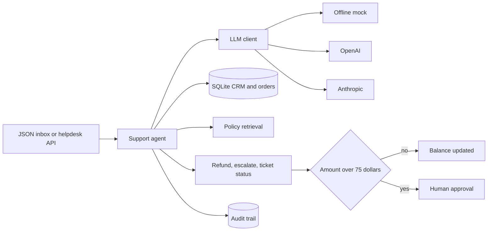
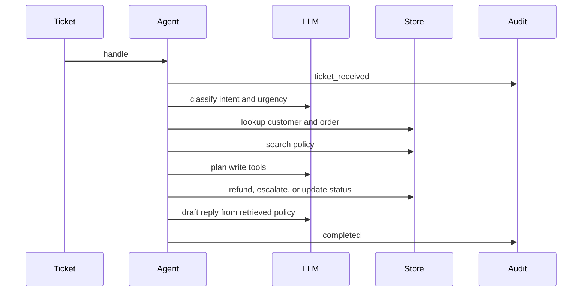

# support-ticket-agent

Portfolio demo for [Arpan Bom](https://github.com/applycoding), a full-stack and AI engineer who connects agents to enterprise tools.

This repository is a **customer-support operations agent**. It is a separate project from a multi-agent workflow demo and from an MCP server for Jira and GitHub. Customers, orders, tickets, and policy text are synthetic. The default LLM is a deterministic offline mock, so the demo runs with no API keys.

## What it does

The agent reads a support email or helpdesk ticket, classifies intent and urgency, loads the customer and order from a SQLite CRM, retrieves a short policy passage, and drafts a reply from that passage. It can issue a refund, escalate to a person, and update the ticket. Every step is written to an audit trail.

Refunds at or under **$75.00** are applied immediately. Refunds above that limit are parked. No balance changes until a person approves them. The demo clock is frozen at **2026-04-10** so refund windows stay stable.

## Architecture





The mock planner and the refund tool both call `evaluate_refund_policy`. A live model can propose a refund, and the tool still refuses anything the policy does not allow.

## Layout

| Path | Role |
| --- | --- |
| `src/support_ops/agent.py` | Classify, ground, act, draft, audit |
| `src/support_ops/llm.py` | Mock, OpenAI, and Anthropic clients |
| `src/support_ops/policy.py` | Refund windows, courtesy credit, approval limit |
| `src/support_ops/store.py` | SQLite CRM, tickets, refunds, audit |
| `src/support_ops/api.py` | FastAPI helpdesk and approval routes |
| `src/support_ops/cli.py` | `process`, `eval`, `serve`, `approve`, `deny` |
| `src/support_ops/eval_harness.py` | Labeled-ticket scores and the CI gate |
| `data/policies/` | Refund, shipping, escalation, and tone notes |
| `data/inbox/sample_tickets.json` | Sample inbox |
| `evals/dataset.json` | 16 labeled tickets |
| `evals/thresholds.json` | Minimum scores (all 1.0) |

## Quick start

Requires Python 3.11 or newer.

```bash
python -m pip install -e ".[dev]"
python -m support_ops process --reset --inbox data/inbox/sample_tickets.json --provider mock
```

`--reset` deletes the local demo database so refund ids start at `REF-0001`. `--provider mock` ignores any keys in the environment.

Approve the parked laptop-stand refund:

```bash
python -m support_ops approve REF-0002 --reviewer "A. Bom"
```

Score the labeled set (always mock mode, always the frozen business date):

```bash
python -m support_ops eval
```

Start the API on `127.0.0.1:8000`:

```bash
python -m support_ops serve
```

Useful routes: `POST /v1/tickets/process`, `GET /v1/tickets/{id}/audit`, `POST /v1/helpdesk/tickets`, `POST /v1/helpdesk/process-open`, `GET /v1/orders/{id}`, `GET /v1/customers?email=`, `POST /v1/refunds/{id}/decision` with `{"decision": "approve", "reviewer": "A. Bom"}`.

Copy `.env.example` if you want OpenAI or Anthropic. A missing key falls back to the mock. Do not commit keys.

## Sample run

```text
Support Ops Agent
portfolio demo, synthetic inbox
llm_provider: mock
business_date: 2026-04-10
auto_approve_limit: $75.00
tickets: 6

TCK-1001  refund_request  medium
  customer: Maya Chen <maya.chen@example.com>
  order: ORD-1001
  tools: lookup_customer, lookup_order, search_policy, issue_refund, update_ticket_status
  refund: approved $42.00 (under $75.00 auto-approve limit)
  escalated: false
  status: resolved
  reply:
    Hello Maya,

    I reviewed your refund request for order ORD-1001 (Headphones, $42.00).
    Policy reference: Refund Policy / Window. Change-of-mind refund window: a refund is available for 30 days after delivery. Unopened items use the same refund window. A defect refund is available for 9...
    I approved the refund under the automatic limit.
    We approved a refund of $42.00 on order ORD-1001. The amount is within the $75.00 automatic approval limit.
    This note is from the support operations demo assistant.

TCK-1002  refund_request  medium
  customer: Luis Ortega <luis.ortega@example.com>
  order: ORD-1002
  tools: lookup_customer, lookup_order, search_policy, issue_refund, escalate_to_human, update_ticket_status
  refund: pending_approval $240.00 (above $75.00 limit, human approval required)
  escalated: true
  status: awaiting_approval

TCK-1005  account_access  critical
  customer: Elena Rossi <elena.rossi@example.com>
  order: ORD-1005
  tools: lookup_customer, lookup_order, search_policy, escalate_to_human, update_ticket_status
  refund: none
  escalated: true
  status: escalated

TCK-1006  shipping_delay  high
  customer: Jordan Blake <jordan.blake@example.com>
  order: ORD-1006
  refund: pending_approval $120.00 (above $75.00 limit, human approval required)
  status: awaiting_approval

TCK-1008  product_defect  high
  customer: Chris Adeyemi <chris.adeyemi@example.com>
  order: ORD-1008
  refund: approved $64.00 (under $75.00 auto-approve limit)
  status: resolved

TCK-1011  general_inquiry  low
  customer: Casey Nguyen <casey.nguyen@example.com>
  order: none
  refund: none
  status: resolved
```

After `support-ops approve REF-0002 --reviewer "A. Bom"`:

```text
Refund REF-0002  decision=approve  reviewer=A. Bom
  status: approved
  gate: human_approved
  order ORD-1002 refunded_cents=24000 status=refunded
  ticket TCK-1002 status=resolved
```

## Policy the agent enforces

| Case | Result |
| --- | --- |
| Change of mind, delivered, 30 days or fewer, amount at or under $75 | Approved |
| Same request above $75 | Pending until a person approves |
| Defect, delivered, 90 days or fewer | Same dollar gate |
| In transit 7 to 13 days | Courtesy credit up to $15 |
| In transit 14 days or more, customer says the package is lost | Refund of the remaining balance, same dollar gate |
| Cancellation before shipment | Refund of the remaining balance |
| Account access, billing dispute, unknown order, or wrong customer | Escalated, no refund |

## Evals and CI

`evals/dataset.json` holds 16 labeled tickets. The harness scores intent accuracy, tool choice, and policy compliance. Policy compliance checks outcomes and the database: no automatic refund above $75, a pending refund does not move money, balances never exceed the order total, the reply cites a retrieved policy title, and the audit trail records the steps.

`evals/thresholds.json` requires 1.0 on all three. `python -m support_ops.eval_harness` exits non-zero when a score is below its threshold. GitHub Actions runs Ruff, pytest, and that harness in mock mode on Python 3.11.

## Tests

```bash
ruff check .
ruff format --check .
pytest -q
python -m support_ops.eval_harness
```
